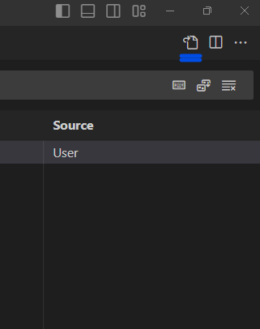

# Key bindings

Applies to **Visual Studio Code** and **Kiro** (Kiro is built on VS Code, so the `keybindings.json` format is the same).

To create key bindings: Go to _File_ > _Preferences_ > _Keyboard Shortcuts_

Then click on the following button (Open keyboard shortcuts).



The **keybindings.json** file will open. Within it, you can write the associations.

You can also open it manually at:

| IDE                 | OS      | Path                                                    |
| ------------------- | ------- | ------------------------------------------------------- |
| Visual Studio Code  | macOS   | `~/Library/Application Support/Code/User/keybindings.json` |
| Visual Studio Code  | Windows | `%APPDATA%\Code\User\keybindings.json`                  |
| Visual Studio Code  | Linux   | `~/.config/Code/User/keybindings.json`                  |
| Kiro                | macOS   | `~/Library/Application Support/Kiro/User/keybindings.json` |

## Example: `console.log` of the selected text

Select a text (for example `user`) and press the shortcut. A new line is inserted **below** with the log, keeping the original code untouched and respecting the indentation:

```js
console.log("user: ", user);
```

```jsonc
[
  {
    // macOS. On Windows/Linux use "ctrl+shift+v"
    "key": "cmd+shift+v",
    "command": "runCommands",
    "when": "editorTextFocus && editorHasSelection && !editorReadonly",
    "args": {
      "commands": [
        // 1. Copy the selected text to the clipboard
        "editor.action.clipboardCopyAction",
        // 2. Insert a new line below (with indentation)
        "editor.action.insertLineAfter",
        // 3. Write the log using the clipboard content
        {
          "command": "editor.action.insertSnippet",
          "args": {
            "snippet": "console.log(\"${CLIPBOARD}: \", ${CLIPBOARD});"
          }
        }
      ]
    }
  }
]
```

### How it works

- `editor.action.insertSnippet` can read the selection with `${TM_SELECTED_TEXT}`, but once the new line is inserted the selection is gone. That is why the selection is copied first and the snippet uses `${CLIPBOARD}`.
- `runCommands` runs the three commands in sequence with a single shortcut.
- `editorHasSelection` in the `when` clause makes the shortcut work only if there is selected text. Without it, an empty selection would write an invalid `console.log("": , );`.

### Things to keep in mind

- **It overwrites your clipboard.** The selected text stays copied after using the shortcut.
- **Shortcut conflicts.** `Cmd+Shift+V` (`Ctrl+Shift+V` on Windows/Linux) opens the Markdown preview. With this `when` clause, the override only happens when there is a selection.
  - The previous version of this guide used `Ctrl+Shift+L`, which conflicts with _Select All Occurrences of Selection_ (`Cmd+Shift+L` on macOS), so it was replaced.
  - You can change `"key"` to any other combination. Check for conflicts in _Keyboard Shortcuts_ before choosing one.
- **Operating system.** Use `cmd` on macOS and `ctrl` on Windows/Linux.
- **Reload.** The IDE usually picks up changes automatically. If not, run _Developer: Reload Window_ from the command palette.

## Alternative: replace the selection

If you prefer replacing the selected text instead of adding a new line, use this simpler version. It does not touch the clipboard:

```jsonc
[
  {
    "key": "cmd+shift+v",
    "command": "editor.action.insertSnippet",
    "when": "editorTextFocus && editorHasSelection && !editorReadonly",
    "args": {
      "snippet": "console.log(\"${TM_SELECTED_TEXT}: \", ${TM_SELECTED_TEXT});"
    }
  }
]
```

> The selected text is replaced by the `console.log`, so the original line is lost.
